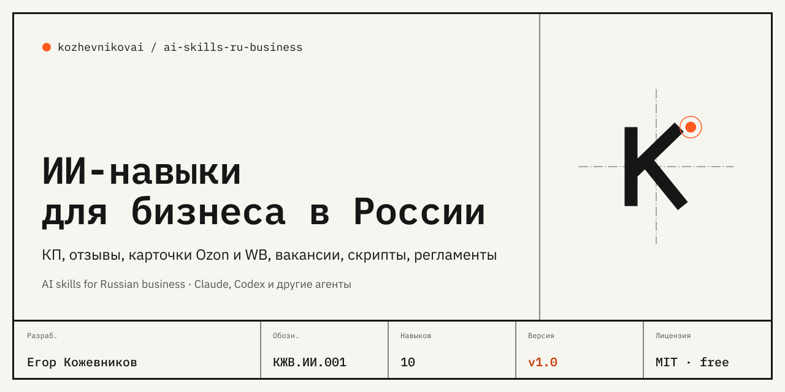

<p align="center"></p>

<p align="center">
<a href="https://github.com/kozhevnikovai/ai-skills-ru-business/releases"></a>
<a href="https://github.com/kozhevnikovai/ai-skills-ru-business/actions/workflows/validate.yml"></a>
<a href="LICENSE"></a>
<a href="README.md"></a>
</p>

# AI skills for business in Russia

**KZH.AI.001** · Ready-made Agent Skills for Claude, Codex and other AI agents that handle the everyday work of Russian-speaking businesses: sales proposals, replies to reviews, Ozon and Wildberries product cards, hh.ru job postings, sales call scripts and SOPs.

- **Free and open source** — MIT license.
- **Built for the Russian market** — Yandex Maps, 2GIS, Ozon, Wildberries, hh.ru; respects Russian advertising (38-FZ), personal data (152-FZ) and labor law.
- **Tested** — 20 eval cases for quality and rule compliance.
- **No made-up facts** — prices, case studies and specs are never invented; gaps are marked `[уточнить]` ("to clarify").

The skills work in Russian: instructions, triggers and outputs are in Russian, because that is where they are used.

## Skills

| Skill | What it does | Example |
|---|---|---|
| [commercial-proposal](skills/commercial-proposal/SKILL.md) | Sales proposal from a short brief | [view](examples/commercial-proposal.md) |
| [review-reply](skills/review-reply/SKILL.md) | Replies to reviews on Yandex Maps, 2GIS, Ozon, WB | [view](examples/review-reply.md) |
| [marketplace-card](skills/marketplace-card/SKILL.md) | Product card for Ozon, WB, Yandex Market | [view](examples/marketplace-card.md) |
| [hh-vacancy](skills/hh-vacancy/SKILL.md) | Job posting for hh.ru plus interview questions | [view](examples/hh-vacancy.md) |
| [cold-outreach](skills/cold-outreach/SKILL.md) | Personalized first message and follow-ups | [view](examples/cold-outreach.md) |
| [meeting-to-tasks](skills/meeting-to-tasks/SKILL.md) | Meeting transcript → minutes and tasks | [view](examples/meeting-to-tasks.md) |
| [sop-builder](skills/sop-builder/SKILL.md) | Standard operating procedure for staff | [view](examples/sop-builder.md) |
| [call-script](skills/call-script/SKILL.md) | Call script with objection handling | [view](examples/call-script.md) |
| [social-post](skills/social-post/SKILL.md) | Posts for Telegram, VK, Dzen and a content plan | [view](examples/social-post.md) |
| [deal-next-step](skills/deal-next-step/SKILL.md) | Client chat analysis → next best step | [view](examples/deal-next-step.md) |

## Install

**Claude Code:**

```bash
git clone https://github.com/kozhevnikovai/ai-skills-ru-business.git && bash ai-skills-ru-business/scripts/install.sh
```

**Claude apps** — download a skill ZIP from [Releases](https://github.com/kozhevnikovai/ai-skills-ru-business/releases) and upload it in the Skills section of Claude settings.

**Other agents** — the skills follow the open Agent Skills format (a folder with `SKILL.md`); copy the folders from `skills/` into your agent's skills directory.

## Quality

- `scripts/validate.py` checks every skill's structure in CI.
- `evals/` — 20 [promptfoo](https://www.promptfoo.dev/) test cases: `npx promptfoo@latest eval -c evals/promptfooconfig.yaml` (needs `ANTHROPIC_API_KEY`).

References to laws are guidance, **not legal advice**. Always review the output before sending it to a client.

## Author

**Egor Kozhevnikov** — AI implementation for business and open-source tools for it. GitHub: [@kozhevnikovai](https://github.com/kozhevnikovai)

License: [MIT](LICENSE).
