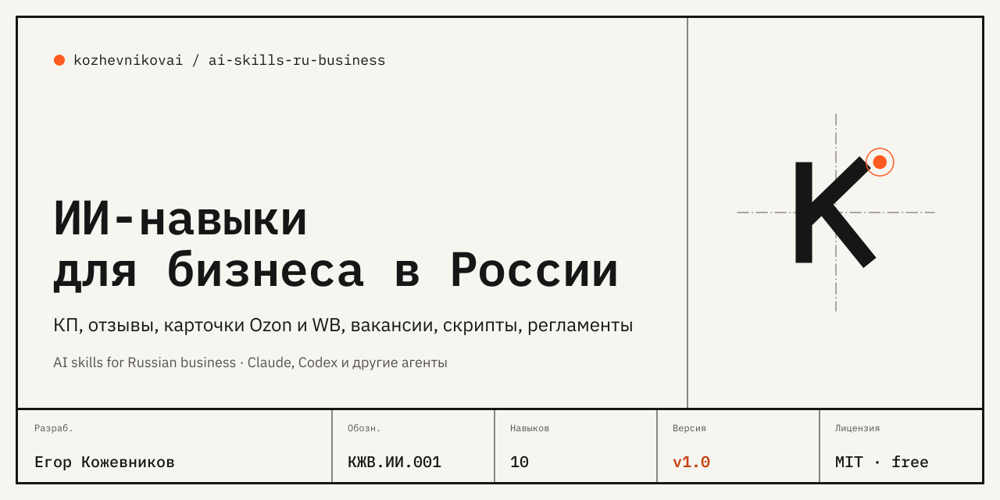

<p align="center"></p>

<p align="center">
<a href="https://github.com/kozhevnikovai/ai-skills-ru-business/releases"></a>
<a href="https://github.com/kozhevnikovai/ai-skills-ru-business/actions/workflows/validate.yml"></a>
<a href="LICENSE"></a>
<a href="README.en.md"></a>
</p>

# ИИ-навыки для бизнеса в России

**КЖВ.ИИ.001** · Готовые навыки (Agent Skills) для Claude, Codex и других ИИ-агентов. Делают ежедневную работу российского бизнеса: коммерческие предложения, ответы на отзывы, карточки для Ozon и WB, вакансии для hh.ru, скрипты продаж, регламенты.

- **Бесплатно и с открытым кодом** — лицензия MIT.
- **Под российские реалии** — Яндекс Карты, 2ГИС, Ozon, Wildberries, hh.ru; учитывают 38-ФЗ «О рекламе», 152-ФЗ, ТК РФ.
- **Проверены автотестами** — 20 тестовых задач на качество и соблюдение правил.
- **Не выдумывают** цены, кейсы и характеристики: пробелы помечаются `[уточнить]`.

> Навык — это методика, которую агент подгружает сам, когда видит подходящую задачу. Вы пишете «сделай КП для клиента…», а агент работает по проверенной структуре, а не «из головы».

## Навыки

| Навык | Что делает | Пример |
|---|---|---|
| [commercial-proposal](skills/commercial-proposal/SKILL.md) | Коммерческое предложение по брифу | [смотреть](examples/commercial-proposal.md) |
| [review-reply](skills/review-reply/SKILL.md) | Ответы на отзывы: Яндекс Карты, 2ГИС, Ozon, WB | [смотреть](examples/review-reply.md) |
| [marketplace-card](skills/marketplace-card/SKILL.md) | Карточка товара для Ozon, WB, Маркета | [смотреть](examples/marketplace-card.md) |
| [hh-vacancy](skills/hh-vacancy/SKILL.md) | Вакансия для hh.ru и вопросы для собеседования | [смотреть](examples/hh-vacancy.md) |
| [cold-outreach](skills/cold-outreach/SKILL.md) | Персональное первое письмо и follow-up | [смотреть](examples/cold-outreach.md) |
| [meeting-to-tasks](skills/meeting-to-tasks/SKILL.md) | Расшифровка встречи → протокол и задачи | [смотреть](examples/meeting-to-tasks.md) |
| [sop-builder](skills/sop-builder/SKILL.md) | Регламент или инструкция для сотрудников | [смотреть](examples/sop-builder.md) |
| [call-script](skills/call-script/SKILL.md) | Скрипт звонка с отработкой возражений | [смотреть](examples/call-script.md) |
| [social-post](skills/social-post/SKILL.md) | Посты для Telegram, ВК, Дзена и контент-план | [смотреть](examples/social-post.md) |
| [deal-next-step](skills/deal-next-step/SKILL.md) | Разбор переписки с клиентом → следующий шаг | [смотреть](examples/deal-next-step.md) |

## До и после

**Запрос:** «Ответь на отзыв: "Ждали заказ 40 минут, пицца холодная. Больше не закажем." ★1. Факты: курьер задержался на другом адресе, пиццу не уложили в термосумку. Отвечает администратор Ольга.»

**Без навыка:**
> Уважаемый клиент! Приносим извинения за доставленные неудобства. Ваше мнение очень важно для нас. Мы обязательно примем меры.

**С навыком `review-reply`:**
> Здравствуйте! Холодная пицца после 40 минут ожидания — это не то, за чем вы к нам обращались, извините. Курьер задержался на соседнем адресе, а коробку не уложили в термосумку как положено. С курьерами провели разбор. Напишите нам в сообщения карточки — администратор Ольга свяжется с вами лично.
>
> *Внутреннее действие: проверить укладку в термосумки на вечерних сменах.*

## Установка

**Claude Code** — одной командой:

```bash
git clone https://github.com/kozhevnikovai/ai-skills-ru-business.git && bash ai-skills-ru-business/scripts/install.sh
```

Навыки окажутся в `~/.claude/skills/`. Другая папка: `bash scripts/install.sh /путь/к/skills`.

**Claude (веб, десктоп, мобильное приложение)** — скачайте ZIP нужного навыка в [Releases](https://github.com/kozhevnikovai/ai-skills-ru-business/releases) и загрузите его в разделе навыков (Skills) в настройках Claude.

**Другие агенты** — навыки сделаны по открытому стандарту Agent Skills (папка с `SKILL.md`). Скопируйте папки из `skills/` в каталог навыков вашего агента. Если формат не поддерживается — вставьте текст `SKILL.md` в начало чата как инструкцию.

## Качество

- `scripts/validate.py` — проверка структуры каждого навыка, запускается в CI на каждый коммит.
- `evals/` — 20 автотестов на [promptfoo](https://www.promptfoo.dev/): правило «не выдумывать», защита персональных данных, 38-ФЗ, запрет дискриминации в вакансиях и другие.

```bash
export ANTHROPIC_API_KEY=...
npx promptfoo@latest eval -c evals/promptfooconfig.yaml
```

## Важно

- Упоминания законов — ориентир для безопасной работы, **а не юридическая консультация**.
- Проверяйте результат перед отправкой клиенту.

## Участие

Нужен навык под вашу задачу? Опишите её в [Issues](https://github.com/kozhevnikovai/ai-skills-ru-business/issues/new/choose) или пришлите PR — см. [CONTRIBUTING.md](CONTRIBUTING.md). История версий — [CHANGELOG.md](CHANGELOG.md).

Если навыки сэкономили вам время — поставьте звезду репозиторию, так их найдут другие.

## Автор

**Егор Кожевников** — внедряю ИИ в бизнес и делаю open-source инструменты для этого. GitHub: [@kozhevnikovai](https://github.com/kozhevnikovai)

Лицензия [MIT](LICENSE).
